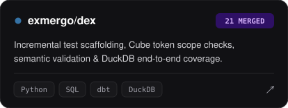
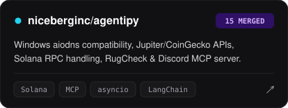
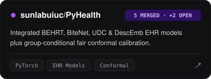
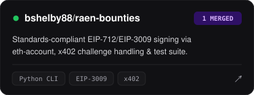
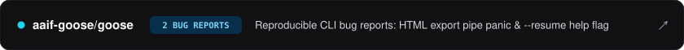
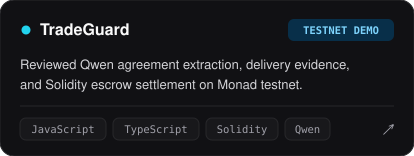
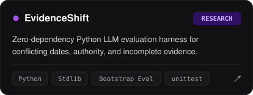
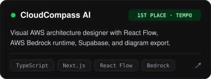
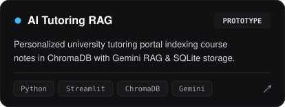
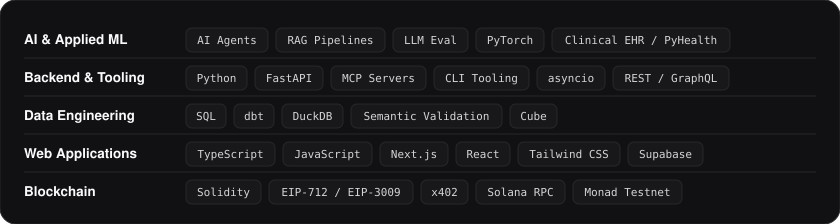

<picture>
  <source media="(prefers-color-scheme: dark)" srcset="./assets/hero-dark.svg" />
  <source media="(prefers-color-scheme: light)" srcset="./assets/hero-light.svg" />
  
</picture>

I’m **Ibrahim Rabiu**, an AI and software engineer and founder of [DevClans Solution Ltd](https://devclans.org.ng) in Nigeria. I build AI agents, business automation, and web applications, and contribute to open-source tools for developers, data teams, and applied machine learning.

### Open-Source Impact

  <a href="https://github.com/exmergo/dex/pulls?q=is%3Apr+author%3AAlhibb+is%3Amerged"><picture><source media="(prefers-color-scheme: dark)" srcset="./assets/oss-dex-dark.svg" /><source media="(prefers-color-scheme: light)" srcset="./assets/oss-dex-light.svg" /></picture></a>&nbsp;<a href="https://github.com/niceberginc/agentipy/pulls?q=is%3Apr+author%3AAlhibb+is%3Amerged"><picture><source media="(prefers-color-scheme: dark)" srcset="./assets/oss-agentipy-dark.svg" /><source media="(prefers-color-scheme: light)" srcset="./assets/oss-agentipy-light.svg" /></picture></a>

  <a href="https://github.com/sunlabuiuc/PyHealth/pulls?q=is%3Apr+author%3AAlhibb+is%3Amerged"><picture><source media="(prefers-color-scheme: dark)" srcset="./assets/oss-pyhealth-dark.svg" /><source media="(prefers-color-scheme: light)" srcset="./assets/oss-pyhealth-light.svg" /></picture></a>&nbsp;<a href="https://github.com/bshelby88/raen-bounties/pull/28"><picture><source media="(prefers-color-scheme: dark)" srcset="./assets/oss-raen-dark.svg" /><source media="(prefers-color-scheme: light)" srcset="./assets/oss-raen-light.svg" /></picture></a>

  <a href="https://github.com/aaif-goose/goose/issues?q=is%3Aissue+author%3AAlhibb"><picture><source media="(prefers-color-scheme: dark)" srcset="./assets/oss-goose-dark.svg" /><source media="(prefers-color-scheme: light)" srcset="./assets/oss-goose-light.svg" /></picture></a>

  Selected PRs &amp; reports: <a href="https://github.com/exmergo/dex/pull/1175">dex #1175</a> · <a href="https://github.com/exmergo/dex/pull/1144">dex #1144</a> · <a href="https://github.com/niceberginc/agentipy/pull/69">agentipy #69</a> · <a href="https://github.com/niceberginc/agentipy/pull/137">agentipy #137</a> · <a href="https://github.com/sunlabuiuc/PyHealth/pull/1517">PyHealth #1517</a> · <a href="https://github.com/sunlabuiuc/PyHealth/pull/1530">PyHealth #1530</a> · <a href="https://github.com/bshelby88/raen-bounties/pull/28">raen #28</a> · <a href="https://github.com/aaif-goose/goose/issues/13296">goose #13296</a> · <a href="https://github.com/aaif-goose/goose/issues/13547">goose #13547</a>

### Selected Projects

  <a href="https://github.com/Alhibb/metropolis_tradeguard"><picture><source media="(prefers-color-scheme: dark)" srcset="./assets/proj-tradeguard-dark.svg" /><source media="(prefers-color-scheme: light)" srcset="./assets/proj-tradeguard-light.svg" /></picture></a>&nbsp;<a href="https://github.com/Alhibb/EvidenceShift"><picture><source media="(prefers-color-scheme: dark)" srcset="./assets/proj-evidenceshift-dark.svg" /><source media="(prefers-color-scheme: light)" srcset="./assets/proj-evidenceshift-light.svg" /></picture></a>

  <a href="https://github.com/Alhibb/CloudCompassAI"><picture><source media="(prefers-color-scheme: dark)" srcset="./assets/proj-cloudcompass-dark.svg" /><source media="(prefers-color-scheme: light)" srcset="./assets/proj-cloudcompass-light.svg" /></picture></a>&nbsp;<a href="https://github.com/Alhibb/ai-tutoring-rag"><picture><source media="(prefers-color-scheme: dark)" srcset="./assets/proj-tutoring-rag-dark.svg" /><source media="(prefers-color-scheme: light)" srcset="./assets/proj-tutoring-rag-light.svg" /></picture></a>

  Verified demos &amp; docs: <a href="https://cloudcompassai.vercel.app">CloudCompass AI Live Demo ↗</a> · <a href="https://github.com/Alhibb/EvidenceShift/blob/main/evidenceshift_v2/README.md">EvidenceShift v2 Protocol ↗</a>

### Capabilities

<picture>
  <source media="(prefers-color-scheme: dark)" srcset="./assets/stack-dark.svg" />
  <source media="(prefers-color-scheme: light)" srcset="./assets/stack-light.svg" />
  
</picture>

### Activity

<picture>
  <source media="(prefers-color-scheme: dark)" srcset="./assets/summary-dark.svg" />
  <source media="(prefers-color-scheme: light)" srcset="./assets/summary-light.svg" />
  
</picture>

<!-- ACTIVITY_SUMMARY:START -->
Updated 2026-11-21 22:37 UTC · <strong>43 merged PRs</strong> across featured upstream projects (<code>exmergo/dex</code>: 22, <code>agentipy</code>: 15, <code>PyHealth</code>: 5, <code>raen-bounties</code>: 1) · <strong>208</strong> rolling-year public contributions · <strong>2 bug reports</strong> on <code>aaif-goose/goose</code>.
<!-- ACTIVITY_SUMMARY:END -->

 

  
  
  
  

  <a href="https://x.com/I_Bakondare">X (@I_Bakondare)</a> · <a href="https://huggingface.co/Alhibb">Hugging Face</a> · <a href="https://dev.to/alhibb">Dev.to</a> · <a href="https://t.me/alhibb">Telegram</a> · Discord: <code>@alhibb</code>

