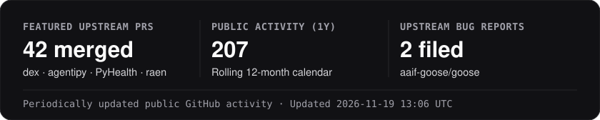

<picture>
  <source media="(prefers-color-scheme: dark)" srcset="./assets/hero-dark.svg" />
  <source media="(prefers-color-scheme: light)" srcset="./assets/hero-light.svg" />
  
</picture>

I’m **Ibrahim Rabiu**, an AI and software engineer and founder of [DevClans Solution Ltd](https://devclans.org.ng) in Nigeria. I build AI agents, business automation, and web applications, and contribute to open-source tools for developers, data teams, and applied machine learning.

---

## Selected Open-Source Contributions

<!-- OSS_IMPACT:START -->
*42 merged PRs across the four featured upstream codebases below, plus 2 reproducible bug reports on Goose (updated 2026-11-19 12:49 UTC).*

### [exmergo/dex](https://github.com/exmergo/dex) — 21 merged PRs (1 open PR under review)
Open-source Python, SQL, and dbt data-engineering toolkit. Contributed incremental test scaffolding fixes, Cube token scope enforcement, semantic layer validation, YAML variable reference discovery, and DuckDB end-to-end test coverage.
- **Selected PRs:** [Cube `dex_scopes` enforcement (#1175)](https://github.com/exmergo/dex/pull/1175) · [Incremental test scaffold fix (#1144)](https://github.com/exmergo/dex/pull/1144)
- **Verify:** [All merged PRs by @Alhibb](https://github.com/exmergo/dex/pulls?q=is%3Apr+author%3AAlhibb+is%3Amerged)

### [niceberginc/agentipy](https://github.com/niceberginc/agentipy) — 15 merged PRs (2 open PRs)
Python toolkit for connecting AI agents to Solana protocols and data sources. Contributed Windows `asyncio`/`aiodns` compatibility, Jupiter and CoinGecko integrations, Solana RPC response handling, LangChain/RugCheck tooling, a Discord MCP server, and examples.
- **Selected PRs:** [Windows `aiodns` event-loop fix (#69)](https://github.com/niceberginc/agentipy/pull/69) · [Discord MCP server (#137)](https://github.com/niceberginc/agentipy/pull/137)
- **Verify:** [All merged PRs by @Alhibb](https://github.com/niceberginc/agentipy/pulls?q=is%3Apr+author%3AAlhibb+is%3Amerged)

### [sunlabuiuc/PyHealth](https://github.com/sunlabuiuc/PyHealth) — 5 merged PRs (1 open PR under review)
Open-source deep learning framework for healthcare and electronic health records. Implemented and integrated published clinical models—BEHRT, BiteNet, UDC, and DescEmb—in `pyhealth.models`, plus a group-conditional fair conformal predictor in `pyhealth.calib`.
- **Selected PRs:** [BEHRT EHR model integration (#1517)](https://github.com/sunlabuiuc/PyHealth/pull/1517) · [DescEmb code-embedding model integration (#1530)](https://github.com/sunlabuiuc/PyHealth/pull/1530)
- **Verify:** [All merged PRs by @Alhibb](https://github.com/sunlabuiuc/PyHealth/pulls?q=is%3Apr+author%3AAlhibb+is%3Amerged)

### [bshelby88/raen-bounties](https://github.com/bshelby88/raen-bounties) — 1 merged PR
Python CLI for x402 micropayment workflows. Replaced ad-hoc EIP-712/EIP-3009 signing with standards-compliant typed-data signing via `eth-account`, fixing challenge handling, nonce consistency, spending limits, and test coverage.
- **Verify:** [Standards-compliant EIP-3009 signing & x402 handling (#28)](https://github.com/bshelby88/raen-bounties/pull/28)

### [aaif-goose/goose](https://github.com/aaif-goose/goose) — 2 bug reports (issues, not code PRs)
Open-source developer agent CLI. Filed reproducible CLI bug reports with isolated scripts, synthetic fixtures, and logs covering a session HTML export panic when piped to `head` and misleading `--resume` flag help output.
- **Verify:** [Session HTML export pipe panic (#13296)](https://github.com/aaif-goose/goose/issues/13296) · [Unsupported `--resume` help output (#13547)](https://github.com/aaif-goose/goose/issues/13547)
<!-- OSS_IMPACT:END -->

---

## Selected Projects

### [TradeGuard (`metropolis_tradeguard`)](https://github.com/Alhibb/metropolis_tradeguard) · *Testnet demo*
- **Problem:** Physical-trade delivery disputes often lack a unified record connecting agreed terms, delivery evidence, and settlement decisions.
- **Implementation:** Combines human-reviewed Qwen term extraction from trade agreements, delivery evidence tracking, a local rehearsal sandbox, and Solidity escrow contracts on Monad testnet with wallet-enforced buyer, supplier, and arbitrator roles. Built by DevClans as the canonical Metropolis hackathon showcase (superseding the earlier `Alhibb/TradeGuard` working draft).
- **Stack:** JavaScript, TypeScript, Solidity, Qwen

### [EvidenceShift](https://github.com/Alhibb/EvidenceShift) · *Research project*
- **Problem:** Evaluating how LLM assistants handle conflicting dates, source authority, and incomplete evidence requires controlled, reproducible benchmarks rather than ad-hoc prompting.
- **Implementation:** Zero-dependency Python evaluation harness ([`evidenceshift_v2`](https://github.com/Alhibb/EvidenceShift/blob/main/evidenceshift_v2/README.md)) with 40 structured test cases, strict output scoring, paired family-bootstrap analysis, blinded review exports, SHA-256 checksums, and a `unittest` test suite.
- **Stack:** Python (standard library), `unittest`

### [CloudCompass AI](https://github.com/Alhibb/CloudCompassAI) · *Web prototype*
- **Problem:** Designing and iterating on AWS cloud architectures manually is slow for cloud and DevOps engineers.
- **Implementation:** Visual AWS architecture designer combining an interactive React Flow canvas, AWS Bedrock runtime integration, Supabase backend, and diagram image export.
- **Stack:** TypeScript, Next.js, React Flow, AWS Bedrock, Supabase, Tailwind CSS
- **Links:** [Repository](https://github.com/Alhibb/CloudCompassAI) · [Live Demo](https://cloudcompassai.vercel.app)

### [AI Tutoring RAG](https://github.com/Alhibb/ai-tutoring-rag) · *Prototype*
- **Problem:** High student-to-lecturer ratios in large public universities limit individualized academic support.
- **Implementation:** Retrieval-augmented tutoring application with a student portal and administrator dashboard, indexing course material in ChromaDB and generating grounded explanations via Google Gemini with SQLite persistence.
- **Stack:** Python, Streamlit, ChromaDB, Google Gemini API, SQLite

---

## Technical Capabilities

- **AI & Applied ML:** AI agents, RAG pipelines, LLM evaluation harnesses, PyTorch, clinical/EHR model integration & uncertainty calibration (`PyHealth`).
- **Backend & Tooling:** Python, REST/GraphQL APIs, MCP servers, CLI engineering, `asyncio`, automated regression & end-to-end testing.
- **Data & Analytics Engineering:** SQL, dbt, DuckDB, semantic layer validation, Cube configuration.
- **Web Applications:** TypeScript, JavaScript, Next.js, React, Tailwind CSS, Supabase.
- **Blockchain Integrations:** Solidity, EIP-712/EIP-3009 typed-data signing, x402 payment flows, Solana RPC & Monad testnet workflows.

---

## Activity Summary

<picture>
  <source media="(prefers-color-scheme: dark)" srcset="./assets/summary-dark.svg" />
  <source media="(prefers-color-scheme: light)" srcset="./assets/summary-light.svg" />
  
</picture>

<!-- ACTIVITY_SUMMARY:START -->
Public GitHub summary (updated 2026-11-19 12:49 UTC): **42 merged PRs** across the four featured upstream repositories, **206 contributions** in the rolling 12-month public calendar, and **2 bug reports** filed on `aaif-goose/goose`.
<!-- ACTIVITY_SUMMARY:END -->

---

## Contact

- **Portfolio:** [alhibb.devclans.org.ng](https://alhibb.devclans.org.ng)
- **Company:** [DevClans Solution Ltd](https://devclans.org.ng)
- **LinkedIn:** [linkedin.com/in/alhibb](https://www.linkedin.com/in/alhibb/)
- **Email:** [alhibb01@gmail.com](mailto:alhibb01@gmail.com)

*Elsewhere:* [X (@I_Bakondare)](https://x.com/I_Bakondare) · [Hugging Face (@Alhibb)](https://huggingface.co/Alhibb) · [Dev.to (@alhibb)](https://dev.to/alhibb) · [Telegram (@alhibb)](https://t.me/alhibb) · Discord: `@alhibb`
