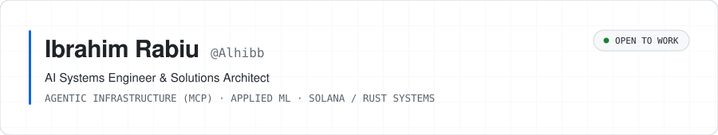

<picture>
  <source media="(prefers-color-scheme: dark)" srcset="./assets/header-dark.svg" />
  <source media="(prefers-color-scheme: light)" srcset="./assets/header-light.svg" />
  
</picture>

 

I design and ship production **AI agent infrastructure**, **applied machine learning pipelines**, and **verifiable on-chain systems on Solana**. Microsoft Certified Trainer (MCT) focused on turning complex distributed and LLM architectures into reliable software.

 

### Selected Open-Source & Systems Work

| Project / Ecosystem | Domain | Engineering Impact |
| :--- | :--- | :--- |
| [**AgentiPy & MCP Server**](https://github.com/niceberginc/agentipy) | `AI Agents` `MCP` `Solana` | Core contributor to the Python framework connecting autonomous AI agents to Solana protocols; built and published the MCP server interface for Claude. |
| [**Exmergo Dex**](https://github.com/exmergo/dex) | `Agent Tooling` `Data Eng` | Shipped manifest-aware `ref()` resolution and transformation reliability fixes for AI-driven analytics engineering workflows. |
| [**PyHealth (UIUC)**](https://github.com/sunlabuiuc/PyHealth) | `Applied ML` `Healthcare` | Implemented clinical sequence modeling (BEHRT for Electronic Health Records) inside the open-source PyHealth modeling suite. |
| [**SmolLM2 Blind Spots**](https://huggingface.co/datasets/Alhibb/smollm2-blind-spots) | `LLM Eval` `Hugging Face` | Curated evaluation dataset probing reasoning failure modes and edge-case blind spots in compact language models. |
| [**Goose AI Agent**](https://github.com/aaif-goose/goose) | `AI CLI` `Developer Tools` | Contributor to CLI session-management ergonomics and agent workflow reliability. |

 

### Architecture & Technical Writing

* **Blueprint:** [Transitioning Production Backend Systems to Verifiable Solana State Machines](https://gist.github.com/Alhibb/3fe50a264cdb4cc6c730a0e11734ec3f) — *Migrating mutable Web2 event/billing pipelines to Rust/Anchor PDA architectures with Bankrun simulation.*
* **Guide:** [Supercharge Claude AI with Solana: Build Your Agentipy MCP Server](https://dev.to/alhibb) — *End-to-end Model Context Protocol implementation for on-chain tool execution.*

 

### Core Stack

| Layer | Technologies |
| :--- | :--- |
| **Languages** | `Python` · `Rust` · `TypeScript` · `SQL` |
| **AI & Agents** | `Model Context Protocol (MCP)` · `PyTorch` · `Transformers` · `LangChain` · `LLM Evals` |
| **On-Chain / Systems** | `Solana` · `Anchor Framework` · `PDA State Machines` · `Bankrun` · `Async IO` |
| **Backend & Cloud** | `PostgreSQL` · `FastAPI` · `Docker` · `dbt` · `GitHub Actions` |

 

---

  <a href="http://alhibb.devclans.org.ng">Portfolio</a> &nbsp;·&nbsp;
  <a href="https://huggingface.co/Alhibb">Hugging Face</a> &nbsp;·&nbsp;
  <a href="https://dev.to/alhibb">Dev.to</a> &nbsp;·&nbsp;
  <a href="https://gist.github.com/Alhibb">Architecture Gists</a>
   
  <a href="https://x.com/I_Bakondare">X</a> &nbsp;·&nbsp;
  <a href="https://www.linkedin.com/in/alhibb/">LinkedIn</a> &nbsp;·&nbsp;
  <a href="https://t.me/alhibb">Telegram</a> &nbsp;·&nbsp;
  <a href="mailto:alhibb01@gmail.com">alhibb01@gmail.com</a> &nbsp;·&nbsp;
  <code>Discord: @alhibb</code>

